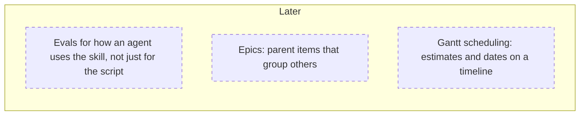

# Roadmap

The Now/Next/Later queue of open work, kept KISS: Markdown files in three
buckets, and nothing more. Each item is one file under
[`items/`](items/). The index below is **generated** from those files by
`scripts/roadmap.py`, so don't edit it by hand.

Closed items, whether shipped or measured and declined, move to
[`archive/`](archive/). [`done.md`](done.md) is their one-line-per-item index.
**Search `done.md` before proposing work.** It answers "has this been tried?"

**Guiding principle:** Stay KISS: plain Markdown in three buckets, with a
checker that stops the roadmap silently drifting out of date. A rule the
checker should enforce but doesn't is a defect; a missing feature such as
dependencies, hierarchy or dates is just a difference.

## The buckets

| Bucket | What it means | Enforced as |
|---|---|---|
| **Now** | The top priority, the way a planned sprint is. It is *not* "being worked on right now". | no `blocked_on` |
| **Next** | Ready, and queued to follow once Now is done. | no `blocked_on` |
| **Later** | Blocked on a *decision*, not on effort. Size or lack of scoping doesn't put an item here. Being **undecided** does. | `blocked_on`, or a `depends_on` item in Later |

`rank` orders items within a bucket, most valuable first, and is unique within
its bucket. When an item depends on another, list it in `depends_on`, and
`check` holds it first: either in an earlier bucket or higher in the same one. People decide the
bucket. An agent may suggest one, but it asks before filing.

The roadmap doesn't track who is working on what, because that would take a
commit every time work starts or stops. An item stays where it is until the
work is done. **Close it in the same branch as the code**, so it moves to
`done.md` when that code merges.

## Open items

<!-- BEGIN INDEX: generated by roadmap.py; edit items/*.md instead -->



### Now (0)

*Empty.*

### Next (0)

*Empty.*

### Later (3)

1. [Evals for how an agent uses the skill, not just for the script](items/agent-behaviour-evals.md) — filed 2026-09-25<br>  **Blocked on:** whether evals that call a model run in CI (cost, nondeterminism) or only on demand
3. [Epics: parent items that group others](items/epics.md) — filed 2026-09-25<br>  **Blocked on:** whether the roadmap grows past KISS to have a hierarchy of items<br>  **Depends on:** [Dependency chaining between items](archive/dependency-chaining.md) (shipped)
4. [Gantt scheduling: estimates and dates on a timeline](items/gantt-scheduling.md) — filed 2026-09-25<br>  **Blocked on:** whether the roadmap should say when work happens, not just what is blocking it<br>  **Depends on:** [Dependency chaining between items](archive/dependency-chaining.md) (shipped)

<!-- END INDEX -->

## Working on this

```bash
python scripts/roadmap.py new <id> --title "..." --bucket now   # file an item
python scripts/roadmap.py move <id> --bucket now                # reprioritise (lands above its dependents, else at the bottom)
python scripts/roadmap.py close <id> --outcome shipped --as <change-or-pr>   # in the same branch as the code
python scripts/roadmap.py index                                 # regenerate this index and done.md
python scripts/roadmap.py check                                 # what CI runs
```

`check` runs in CI, so a broken roadmap fails the build instead of rotting.
It checks that:
- every item's frontmatter is well-formed TOML carrying only known fields
- each bucket's entry criterion actually holds
- every dependency exists, wasn't declined, and comes first
- every `refs` entry and every relative link resolves in the tree
- this index and `done.md` match what the generator renders

### Closing is not scaffolding

Only close an item once the work is **implemented or declined**. Turning an item
into a design doc or a change proposal does not take it out of the queue. What
scaffolding earns is an edit to the item itself, in place:
- **Split it** if it turned out to be two pieces of work.
- **Restate the `gate`** as whatever the work still has to clear.
- **Record what the analysis corrected**, especially where the item's own
  earlier reasoning turned out to be wrong.
- Leave `bucket` alone. Scaffolding changes what is known, not the priority.

### The archive is append-only

Once closed, an entry is never edited again. The one exception is a dated
annotation, added as new lines, marking a claim that later events falsified.
`check --base origin/main` enforces this in pull requests.

### Fix roadmap mistakes forward

More than one agent edits this at a time. **Don't `reset`, `amend` or rebase to
tidy up a roadmap commit**, because that can drop a peer's just-landed commit.
Commit the correction on top and say what it corrects.

### Frontmatter

```toml
+++
id = "matches-the-filename"
title = "One line, rendered into the index"
bucket = "now"          # now | next | later
rank = 1                # unique within the bucket, most valuable first
filed = 2026-09-06      # a bare TOML date, not a string
updated = 2026-09-06    # optional; when the item was last re-argued
gate = "..."            # optional; the bar the work has to clear
blocked_on = "..."      # required for `later` (unless a dependency is), forbidden elsewhere
depends_on = ["other"]  # optional; ids that must come first (keep it above [refs])

[refs]                  # optional; each entry is checked to exist
files = ["src/app.py"]  # other kinds are declared in roadmap.toml
+++
```

`close` removes `bucket`, `rank` and `blocked_on`, and adds
`closed = <date>`, `outcome = "shipped" | "declined"`, and optionally
`shipped_as = "..."`.
